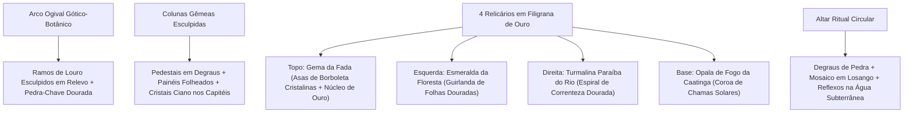

# 🎬 Direção de Cena — Porta Ancestral Grandiosa, Menu & Cutscene dos Sussurros (Tarefa 1) e Mundo 1: Caverna Fases 1–5 (Tarefa 2)

Este documento estabelece a **Direção de Cena, Arte, Paleta, Taxa de Quadros e Arquitetura** antes da implementação de cada animação, garantindo fidelidade absoluta ao estilo **True Pixel Art** da demonstração aprovada e às diretrizes de `Crystal-Math-Mania-mecanicas-organizadas-v2.txt`.

---

## 🏛️ 0. Solução Visual para a Porta Principal (Porta Ancestral Grandiosa)

### Diagnóstico do Problema Anterior
Na primeira versão da demo (`320×180`), a Porta Ancestral ao fundo possuía apenas `48×64` pixels com um arco simples e pequenos losangos de `3×3` pixels para os encaixes. Isso diminuía sua imponência em comparação à arte conceitual aprovada (`menu-aprovado.png` e `porta-estados.png`).

### Solução Arquitetônica em True Pixel Art
A **Porta Ancestral** passa a ser tratada como uma **Catedral Subterrânea Gótico-Botânica Monumental** (`96×112` pixels na grade `320×180` e `192×224` na grade `640×360`), composta por **5 elementos escultóricos de alto detalhamento**:



1. **Arco Ogival Monumental com Relevos Botânicos**: Dupla moldura de pedra azul-cobalto (`#172070` $\rightarrow$ `#2a3aa6` $\rightarrow$ `#4c66d6` $\rightarrow$ `#7aa2ff`) com ramos de folhas esculpidos subindo simetricamente até a pedra-chave central coroada por um losango dourado.
2. **Colunas Gêmeas com Cristais Vivos**: Pilares laterais robustos com base escalonada, entalhes de folhas e **mini-cristais ciano luminescentes** pousados sobre as cornijas intermediárias (pulsando a `12 FPS`).
3. **Os 4 Relicários de Filigrana Dourada (`#8f5618` $\rightarrow$ `#e09a2a` $\rightarrow$ `#ffd35a` $\rightarrow$ `#fff3b0`)**:
   - **Topo — Gema da Fada (Caverna)**: Grande brasão em forma de **asas de borboleta multifacetadas** (facetas em `#ecfeff`, `#9ef0ff`, `#3fc6f0` e `#ff72e0`) com coração em losango dourado e pingentes cristalinos.
   - **Esquerda — Moldura da Floresta (Esmeralda)**: Filigrana em forma de ramos e folhas entrelaçadas ao redor da cavidade oval.
   - **Direita — Moldura do Rio (Turmalina Paraíba)**: Filigrana sinuosa em espiral de onda aquática.
   - **Base — Moldura da Caatinga (Opala de Fogo)**: Filigrana radiante com línguas de fogo solares.
4. **Altar Circular Escalonado e Espelho d'Água**: Plataforma ritual em perspectiva na base da porta com inscrições geométricas que refletem a luz ciano e magenta das drusas de cristal nas águas da caverna (`8 FPS`).

---

## 🎭 1. Tarefa 1 — Direção de Cena: Menu Interativo & Cutscene Longa dos Sussurros

### 1.1 Cena 1A — Menu Principal: *"O Santuário da Porta Ancestral"*
* **Base Visual Mantida**: Composição oficial de `menu-aprovado.png` (logotipo *Crystal Math Mania* à esquerda superior ladeado por cristais ciano e magenta; coluna de escolhas à esquerda; Porta Ancestral monumental à direita refletida no lago subterrâneo).
* **Refatoração em True Pixel Art e Interatividade**:
  - **Camada Pixel Canvas Ao Vivo (`#menuParticles`, grade inteira escalada com `imageSmoothingEnabled = false`)**:
    - **Respiração dos Cristais e da Porta (`12 FPS`)**: As facetas da **Gema da Fada** no topo da Porta Ancestral brilham em ciclo harmônico, emitindo raios sutis em dithering Bayer 4×4 e partículas ascendentes de poeira de cristal (`#9ef0ff`, `#ffc6f2`, `#ffd35a`).
    - **Espelho d'Água Subterrâneo (`8 FPS`)**: Ondulações horizontais pixeladas na água na base da porta, refletindo os cristais ciano e magenta e o brilho dourado dos relicários.
    - **Interação Viva no Cenário**:
      - Passar o mouse ou focar em **Jogar** intensifica o halo da **Gema da Fada** na Porta Ancestral, acende as runas douradas da porta e faz surgir um sussurro sutil convidando o jogador a entrar;
      - Passar o mouse ou focar em **Opções**, **Créditos** ou **Sair** ilumina diferentes drusas de cristal da caverna e emite harmônicos cristalinos (`CrystalAudio`);
      - Clicar diretamente nos cristais ou na Porta Ancestral no fundo do menu toca acordes de cristal e desperta vagalumes/sussurros interativos.

### 1.2 Cena 1B — Cutscene de Introdução Longa: *"O Chamado dos Sussurros"* (`11.5s`)
* **Especificações Técnicas**:
  - **Resolução Lógica do Canvas da Cutscene**: `320×180` (escalada por múltiplo inteiro para tela cheia com `image-rendering: pixelated` e `imageSmoothingEnabled = false`).
  - **Taxas de Quadros**:
    - `60 Hz`: Movimento de câmera, paralaxe das paredes da caverna, aproximação magnética dos cristais demonstrativos e flutuação senoidal das falas.
    - `12 FPS`: Animação das facetas dos cristais, tremor tipográfico dos sussurros (*jitter* pixelado de $\pm 1\text{px}$), quebra sequencial e silhueta da Fada.
    - `24 FPS`: Dithering Bayer 4×4 nas transições de véu, ondas de luz e partículas.
  - **Acessibilidade**: Botão **"Pular animação (`Esc` / `Espaço`)"** sempre visível e focalizável; em modo `Reduzir movimentos` (`prefers-reduced-motion`), exibe os *beats* sem tremor nem rotação brusca.

#### Roteiro de *Beats* da Cutscene de Introdução (`0.0s` a `11.5s`)

| Beat | Tempo | Ação Visual em True Pixel Art | Sussurro Flutuante Trêmulo (Fala na Tela) | Áudio / Efeito |
| :--- | :--- | :--- | :--- | :--- |
| **Beat 1: A Travessia do Portal** | `0.0s – 2.4s` | A câmera avança através das formações rochosas da caverna em paralaxe pixelada em direção ao santuário interno. | *"“...Você consegue ouvir?...”"* <br> *(letras ciano-pálido surgem flutuando e tremendo levemente)* | Drone harmônico profundo + eco de gota cristalina |
| **Beat 2: O Silêncio da Porta e a Prisão no Teto** | `2.4s – 5.2s` | Revela-se a **Porta Ancestral Monumental** adormecida e, no teto da caverna, o **Grande Cristal-Prisão** guardando a silhueta da Fada das Gemas. Ondas concêntricas de voz saem do cristal do teto. | *"“...Estou presa no cristal do alto... A caverna perdeu sua canção...”"* | Acorde etéreo em Lá menor + pulso luminoso na silhueta da Fada |
| **Beat 3: Demonstração Visual 1 — Fusão e Subtração** | `5.2s – 8.2s` | No centro do palco escuro, dois **Quartzos** luminosos (`1` e `2`) deslizam um sobre o outro fundindo-se (`3`), e uma **Opala de Fogo** (`1`) toca o Quartzo reduzindo seu brilho (`2`), exatamente como o jogador fará na Fase 1. | *"“...Arraste Quartzos para somar seus brilhos... use a Opala de Fogo para subtrair...”"* | Som de fusão cristalina + chiado suave de brasa da Opala |
| **Beat 4: Demonstração Visual 2 — Equação e Anulação** | `8.2s – 10.4s` | Dois cristais se conectam por uma **linha energética roxa ondulante** (`12 FPS`) formando uma Equação Cristalina e encontram sua **Equação Sombria** equivalente, quebrando em sequência com fragmentos caindo no chão! | *"“...Toque para conectar equações... e anule cada sombra com sua luz igual!”"* | Clique magnético + combo crescente de quebra de cristal |
| **Beat 5: Despertar no Jogo** | `10.4s – 11.5s` | Um pulso de luz ciano parte da anulação até o cristal da Fada; as pálpebras da caverna se abrem com dithering Bayer 4×4 revelando a **Fase 1** pronta para jogar. | *"“...Restaure os ecos... liberte nossa voz!”"* | Arpejo de despertar em Dó maior |

---

## 💎 2. Tarefa 2 — Direção de Cena: Mundo 1 (Caverna — Fases 1, 2, 3, 4 e 5) & Arquitetura Modular

### 2.1 Arquitetura Desacoplada de Desafios (`window.CrystalChallenges`)
Para garantir que **qualquer desafio das fases possa ser alterado no futuro com facilidade sem tocar nas animações**:
* Criamos um registro declarativo `WORLD1_CHALLENGES` (e para os demais mundos) em [`js/campaign-current.js`](file:///C:/Users/heito/OneDrive/Documentos/GitHub/Sinfonia-dos-Cristais/js/campaign-current.js), separado da definição de cenário/animação (`scene: 'C1'..'C5'`).
* Cada fase é descrita por:
  - `id`: Número da fase (`1..5`);
  - `name`: Título da fase;
  - `hint`: Instrução pedagógica;
  - `whisper`: Frases de sussurros flutuantes trêmulos que ecoam no ambiente da fase;
  - `pieces`: Lista declarativa de cristais (ou *builders* semânticos `fuseAndSubtract(q1, q2, opal)`, `equationMatch([a, b])`, `customChallenge([...])`);
  - `goals`: As 3 etapas exibidas na barra lateral direita.
* **Como as animações permanecem intactas ao mudar o desafio**:
  - O motor de cenário (`CrystalScenery`) e o motor de palco (`CrystalStage`) escutam apenas eventos semânticos normalizados:
    1. `onStepProgress(ratio, originPoint)` $\rightarrow$ Dispara a **Onda de Restauração em Dithering Bayer 4×4 (`24 FPS`)** a partir do ponto de ação, atualizando o cenário de `0%` $\rightarrow$ `33%` $\rightarrow$ `66%` $\rightarrow$ `100%`;
    2. `onCrystalShatter(point, isShadow, comboIndex)` $\rightarrow$ Dispara o flash branco de 2 quadros (`12 FPS`), anéis concêntricos e fragmentos com gravidade no chão;
    3. `onLevelComplete(levelId)` $\rightarrow$ Executa a celebração da peça central da fase (`C1..C5`) e, na Fase 5, a libertação completa da Fada das Gemas e ativação da Porta Ancestral.

### 2.2 Direção de Cena das 5 Fases da Caverna (`C1` a `C5`)

Todas as 5 fases compartilham a linguagem visual da demo (`demo-pixel-art.html`):
- **Fundo em True Pixel Art** com transição entre os 4 estados de restauração via **Onda Radial com Dithering Bayer 4×4 (`24 FPS`)** e borda cintilante `#c8fbff` / `#ffffff` (substituindo o antigo *fade* borrado de CSS);
- **Sussurros Flutuantes Trêmulos (`12 FPS`)** pairando suavemente no ar da caverna sem bloquear o clique nos cristais;
- **Partículas Ambientais Reativas**: Poeira suspensa na caverna escura que se transforma em **vagalumes dourados/ciano (`8 FPS`)** e **estrelas de 4 pontas nos topos dos cristais (`12 FPS`)** conforme a fase é restaurada.

| Fase | Cenário (`scene`) | Elemento Central Animado (`CrystalStage` + `CrystalScenery`) | Estados de Restauração (0% $\rightarrow$ 33% $\rightarrow$ 66% $\rightarrow$ 100%) | Desafio Matemático Inicial (Fácil de Editar) |
| :--- | :--- | :--- | :--- | :--- |
| **Fase 1: O Despertar** | `C1` | **Santuário da Porta Ancestral & Afloramento de Quartzo** | **0%**: Rocha escura e musgo seco diante da Porta Ancestral adormecida.<br>**33%**: Primeiros brotos verdes e pontas de cristal azul despertam.<br>**66%**: Drusas de quartzo ciano iluminam a rocha e cogumelos azuis brotam.<br>**100%**: O afloramento inteiro resplandece com cristais gigantes, vagalumes e reflexos na Porta Ancestral. | **Interações básicas por arrasto**: Dois Quartzos (`1` e `1`) para fundir (`2`), uma Opala de Fogo (`1`) para subtrair (`2 - 1 = 1`) e uma Sombra de Quartzo (`1`) para anular. |
| **Fase 2: Galeria dos Ecos** | `C2` | **As Fontes Gêmeas de Pedra Arqueada** | **0%**: Bacias de pedra rachadas e secas.<br>**33%**: Musgo verde reveste a bacia e um fio de água começa a pingar (`12 FPS`).<br>**66%**: A água cristalina enche a bacia e escorre em cascata animada.<br>**100%**: Cascata luminosa completa com respingos pixelados e cogumelos neon azuis/violetas. | **Introdução às Equações Cristalinas (Clique para conectar)** + **10 Diamantes bônus**: Conectar Quartzo `1` e Quartzo `2` na ordem da equação sombria `[1, 2]` e anular o conjunto. |
| **Fase 3: Lago Subterrâneo** | `C3` | **O Espelho d'Água Subterrâneo** | **0%**: Poça turva e silenciosa cercada por pedras cinzentas.<br>**33%**: A água clareia para azul-profundo e surgem as primeiras ondulações (`8 FPS`).<br>**66%**: Samambaias brotam nas bordas e estrelas de luz brilham na superfície.<br>**100%**: Lago bioluminescente radiante com ondas concêntricas, flores e vagalumes refletidos. | **Reforço de Ordem na Equação**: Conectar três Quartzos (`2`, `1` e `3`) respeitando a estrutura e ordem da equação sombria `[2, 1, 3]`. |
| **Fase 4: Jardim Mineral** | `C4` | **O Grande Geodo Ancestral + Harmonia Especial** | **0%**: Rocha oval maciça fechada com fissura apagada.<br>**33%**: Um raio de luz azul-elétrica percorre a fenda central (`12 FPS`).<br>**66%**: A casca de pedra se abre revelando o núcleo de cristais ciano/violeta.<br>**100%**: O geodo pulsa aberto com cogumelos luminosos e dispara um acorde harmônico especial de pré-libertação da caverna. | **Preparação + Equação**: Fundir Quartzos (`1 + 2 = 3`), conectar ao Quartzo `1` formando `[3, 1]` e anular a equação sombria correspondente. |
| **Fase 5: O Sussurro da Fada** | `C5` | **O Cristal-Prisão do Teto & A Libertação da Fada das Gemas** | **0%**: Cristal pendente no teto com a silhueta adormecida da Fada e sussurros trêmulos.<br>**33%**: Fissuras luminosas brancas ramificam-se pelo cristal.<br>**66%**: O cristal se fragmenta parcialmente com brilho intenso e a Fada desperta.<br>**100% (Libertação)**: Flash branco de 2 quadros, **36 fragmentos caindo com gravidade**, voo curvo da Fada (`12 FPS`), **encaixe da Gema da Fada na Porta Ancestral Grandiosa** e abertura do Desafio Musical! | **Desafio Mestre da Caverna (Subtração + Conexão + Ordem)**: Usar a Opala (`1`) para reduzir o Quartzo (`4 -> 3`), conectar ao Quartzo (`2`) na ordem `[3, 2]` e anular a equação sombria do cristal-prisão. |


---

## 5. Galeria Visual Validada por Playtest Autônomo (True Pixel Art)

````carousel

<!-- slide -->

<!-- slide -->

<!-- slide -->

<!-- slide -->
![Fase 3 — Lago Subterrâneo (C3): Ordem Matemática [2, 1, 3] e Espelho d'Água](C:/Users/heito/.gemini/antigravity/brain/cfb4e569-1b45-4d83-a356-2ec8d61380fc/level-03-start.png)
<!-- slide -->
![Fase 4 — Jardim Mineral (C4): Fusão + Conexão [3, 1] e Geodo Ancestral](C:/Users/heito/.gemini/antigravity/brain/cfb4e569-1b45-4d83-a356-2ec8d61380fc/level-04-start.png)
<!-- slide -->
![Fase 5 — O Sussurro da Fada (C5): Cristal-Prisão da Fada, Sussurro Flutuante e Equação [3, 2]](C:/Users/heito/.gemini/antigravity/brain/cfb4e569-1b45-4d83-a356-2ec8d61380fc/level-05-start.png)
````
