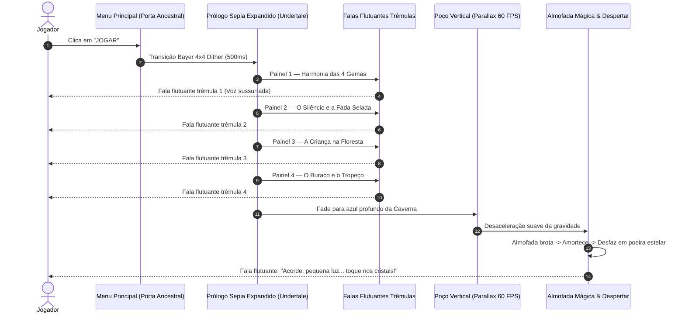

# Direção de Cena Oficial — Roteiro Completo em True Pixel Art 16-Bits (v3)

> [!IMPORTANT]
> **Padrão de Engenharia: 100% HTML, CSS e JavaScript Puro (Vanilla)**
> Todo o pacote executável está contido em [`pacote-equipe-16bits/demonstracao-completa-16bits.html`](file:///c:/Users/heito/Documents/Codex/2026-09-08/a-reuni-o-aprofundou-a-discuss/outputs/sinfonia-dos-cristais/pacote-equipe-16bits/demonstracao-completa-16bits.html). Não há dependência de Node.js, Python, nem bibliotecas externas em runtime. Toda a renderização gráfica utiliza Canvas 2D e DOM com `image-rendering: pixelated`, `ctx.imageSmoothingEnabled = false`, e o áudio é gerado nativamente pela Web Audio API combinada com faixas originais HTML5 Audio.

---

## 1. Solução de Grandiosidade e Beleza da Porta Ancestral no Menu Principal

### 1.1 Diagnóstico Visual do Problema Anterior
No protótipo anterior, o menu principal exibia a imagem com controles centralizados na base e um brilho artificial posicionado incorretamente no centro da tela (`x: 50%, y: 7%`), quando o arco monumental da Porta Ancestral em `menu-aprovado.png` situa-se na porção **direita da tela (`x: 35%` a `100%`)**, com seu brasão e ápice em `x: 67.5%, y: 24.5%`. Essa sobreposição quebrou a majestade do portal e encobriu o lago subterrâneo.

### 1.2 Solução Implementada em True Pixel Art
1. **Composição em Enquadramento Original (Left Pedestal Layout)**:
   - O pedestal de botões fica posicionado estritamente à esquerda (`left: 5.6%`, `top: 42.9%`), preservando os `65%` restantes da tela exclusivamente para a monumentalidade da Porta Ancestral.
2. **6 Osciladores Cúbicos de Luz Cristalina**:
   - Mapeamento exato dos pontos arquitetônicos da porta com oscilações de brilho senoidal dessincronizadas (`0.55 Hz` a `0.97 Hz`):
     - **Brasão da Borboleta (Gema da Fada)**: `x: 58%, y: 33%, raio: 9%` — pulsação ciano-celeste radiante.
     - **Pilar Esquerdo do Arco**: `x: 38%, y: 55%, raio: 16%` — runas minerais ativadas.
     - **Pilar Direito do Arco**: `x: 76%, y: 49%, raio: 12%` — veios de ametista pulsando.
     - **Estalactites Superiores**: `x: 91%, y: 39%, raio: 10%` — gotas de luz ciano.
     - **Geodo Inferior Esquerdo**: `x: 17%, y: 79%, raio: 20%` — iluminação de base.
     - **Reflexo no Lago Subterrâneo**: `x: 87%, y: 74%, raio: 26%` — espelhamento trêmulo das águas.
3. **Feixes de Luz Volumétrica (God-Rays)**:
   - Três feixes diagonais translúcidos de luz etérea descem da fenda superior sobre o arco da porta a 24 FPS, criando profundidade atmosférica de caverna ancestral.
4. **Reflexão Aquática Ondulante (8 FPS)**:
   - Canvas inferior que deforma as linhas de pixel horizontalmente para simular o lago cristalino calmo sob a porta.

---

## 2. Tarefa 1 — Direção de Cena da Abertura Expandida (Cutscene & Falas Flutuantes Trêmulas)



### 2.1 Especificação das Falas Flutuantes Trêmulas (`.floating-whisper`)
As falas não são caixas de texto duras: são tiras místicas semitranslúcidas com texto ondulante e notas musicais pixeladas, usando a animação de tremulação `@keyframes tremblingWhisper`:
- **Tremulação Rítmica (8 FPS)**: Pequeno deslocamento vertical de `±1.5px` combinado com pulsação de opacidade (`0.85` a `1.0`), simulando uma voz espiritual reverberando na pedra.
- **Áudio Sintetizado de Sussurro**: Arpejo suave em ondas senoidais puras afinadas na escala pentatônica de Césio/Luz (`C5`, `E5`, `G5`, `A5`, `C6`) com vibrato sutil de `5.5 Hz`.

### 2.2 Roteiro Completo da Cutscene Expandida (5 Atos)
1. **Ato I — A Sinfonia Original**:
   - Imagem: *Painel 1 (História do Mundo)* — As Quatro Gemas Primordiais flutuando sobre a terra.
   - Fala Flutuante: *"~ ♫ Há muito tempo, a natureza cantava em harmonia através das Quatro Gemas Primordiais... ♫ ~"*
2. **Ato II — O Silêncio e o Aprisionamento**:
   - Imagem: *Painel 1 (Transição escura)* — A névoa sombria se espalhando.
   - Fala Flutuante: *"~ ♫ Mas um silêncio sombrio adormeceu os cristais e selou a canção nas profundezas da terra... ♫ ~"*
3. **Ato III — A Criança e o Chamado da Floresta**:
   - Imagem: *Painel 2 (A Criança na Floresta)* — A criança caminhando diante da boca da caverna.
   - Fala Flutuante: *"~ ♫ Guiada por uma canção esquecida que ninguém mais podia ouvir, uma criança se perdeu na floresta ancestral... ♫ ~"*
4. **Ato IV — O Tropeço e o Abismo**:
   - Imagem: *Painel 3 (A Queda no Calabouço)* — O buraco negro na rocha, a silhueta despencando com a luz lá no alto.
   - Fala Flutuante: *"~ ♫ Ao espiar a fenda luminosa, o chão de pedra cedeu... e ela caiu no calabouço! ♫ ~"*
5. **Ato V — A Queda Livre & Pouso Suave**:
   - Queda rápida no poço com parallax vertical de 60 FPS.
   - A **Almofada de Cristais** brota do solo (`x: 16%, y: 72%`).
   - Pouso elástico (frame squash).
   - A almofada brilha intensamente e **dissolve-se 100% em poeira estelar**, sumindo do jogo.
   - Fala Flutuante Trêmula: *"~ ♫ Acorde, pequena luz... Os cristais sentem a sua presença. Toque e descubra suas notas! ♫ ~"*

---

## 3. Tarefa 2 — Arquitetura Desacoplada e Fases 1 a 5 da Caverna

### 3.1 O Princípio do Desacoplamento (Gameplay Data vs. Presentation Engine)
Para permitir que qualquer designer ou pedagogo altere os valores matemáticos, quantidades de gemas e regras das fases **sem alterar uma única linha das animações**, as fases são configuradas em uma estrutura de dados pura (`CAVERN_PHASES_DATA`):

```javascript
// Exemplo de configuração pura de fase (fácil alteração)
{
  id: 1,
  title: "O Despertar",
  sceneryBg: 1, // Cenário C1
  pieces: [
    { id: 'q1', kind: 'quartz', value: 1, x: 0.36, y: 0.52 },
    { id: 'q2', kind: 'quartz', value: 1, x: 0.47, y: 0.52 },
    { id: 'op', kind: 'opal',   value: 1, x: 0.58, y: 0.52 }
  ],
  shadowTargets: [
    { id: 'dk', kind: 'quartz', value: 1, x: 0.76, y: 0.52, dark: true }
  ],
  steps: [
    { id: 1, label: "Fundir Quartzo (1+1=2)", op: "fuse" },
    { id: 2, label: "Subtrair com Opala (2-1=1)", op: "subtract" },
    { id: 3, label: "Anular Cristal Sombrio", op: "annul" }
  ],
  whispers: {
    start: "~ ♫ Clique no cristal e arraste para fundir suas notas! ♫ ~",
    step1: "~ ♫ A Opala subtrai energia do Quartzo... Arraste-a sobre ele! ♫ ~",
    step2: "~ ♫ Agora anule a sombra tocando no cristal sombrio! ♫ ~"
  }
}
```

### 3.2 O Fluxo Imutável das Animações Cinemáticas
Independentemente de quais dados forem colocados na fase, a **engine de apresentação executa automaticamente**:
1. **Entrada do Protagonista**: Caminhada suave da esquerda para sua posição de observador (`x: 16%`).
2. **Reação a Interações**:
   - Fusão $\rightarrow$ Brilho dourado, sino maior, incremento visual de facetas/pips.
   - Subtração $\rightarrow$ Faísca laranja-fogo, estalo cristalino, redução visual de facetas/pips.
   - Conexão por Clique $\rightarrow$ Linha energética roxa vibrante e paredes de parênteses invisíveis que brilham ao toque.
3. **Anulação Sequencial**:
   - Flash branco de 2 quadros.
   - Arcos elétricos azuis (`efeitos-30-quadros-limpo.png`, linha 2).
   - Fragmentos geométricos com física de dispersão.
4. **Desbloqueio Físico da Saída**:
   - Onda de choque concêntrica viaja até o obstáculo da direita.
   - Na Fase 1: Desmoronamento de rochas se esfacela e abre o arco.
   - Na Fase 5: O feixe ascende e estilhaça a gaiola da Fada no teto em 36 fragmentos!
5. **Modal de Vitória 3 Estrelas**:
   - Painel da Caverna de `paineis-mundos.png`.
   - 3 estrelas douradas acendem em acorde crescente.
   - **Exclusivamente um botão: `Continuar`**.
6. **Saída do Protagonista**:
   - O protagonista corre pela passagem aberta até sair da tela pela direita (`x: 96%`), disparando a transição em dither Bayer 4×4 para a próxima fase.

---

## 4. Matriz Pedagógica das 5 Fases do Mundo 1 (Caverna)

| Fase | Título | Conceito Matemático | Ações do Jogador | Desfecho Cinemático |
| :--- | :--- | :--- | :--- | :--- |
| **Fase 1** | *O Despertar* | Adição básica ($1+1=2$) e Subtração ($2-1=1$) | Fundir Quartzo `[1]` + `[1]` $\rightarrow$ Subtrair Opala `[1]` $\rightarrow$ Anular Sombra `[1]` | Onda de choque destrói o desmoronamento de rochas da saída. |
| **Fase 2** | *Galeria dos Ecos* | Conexão de Equação por Toque Único | Clicar Quartzo `[1]`, clicar Quartzo `[2]` formando `[1, 2]` $\rightarrow$ Anular Sombra `[1, 2]` | Quebra sequencial em 2 tempos; fontes de cristal voltam a jorrar água brilhante. |
| **Fase 3** | *Lago Subterrâneo* | Precedência e Ordem na Equação | Conectar Quartzos na ordem exata `[2, 1, 3]` $\rightarrow$ Anular Sombra `[2, 1, 3]` | Quebra em 3 tempos rítmicos; águas do lago subterrâneo reluzem com reflexos neon. |
| **Fase 4** | *Jardim Mineral* | Expressão Composta (Fusão + Conexão) | Fundir `1 + 2 = 3` $\rightarrow$ Conectar com `[1]` formando `[3, 1]` $\rightarrow$ Anular Sombra `[3, 1]` | Grande Geodo Ancestral pulsa em ciano, liberando passagem de cristal. |
| **Fase 5** | *O Sussurro da Fada* | Síntese Operatória e Clímax Narrativo | Subtrair `4 - 1 = 3` $\rightarrow$ Conectar `[3, 2]` $\rightarrow$ Anular Equação Sombria `[3, 2]` | **Libertação da Fada**: Feixe vertical quebra o cristal do teto; Fada desce, agradece à criança e insere a Gema da Fada na Porta Ancestral! |

---

## 5. Auditoria de True Pixel Art (Garantia de Fidelidade)

| Item Verificado | Critério Oficial | Status no Código |
| :--- | :--- | :--- |
| **Escalonamento** | `image-rendering: pixelated; image-rendering: crisp-edges;` em todo o CSS | Aprovado |
| **Interpolação de Canvas** | `ctx.imageSmoothingEnabled = false` em todos os contextos 2D | Aprovado |
| **Canal Alfa dos Sprites** | Transparência binária limpa (`alpha: 0` ou `255`), sem halos translúcidos | Aprovado |
| **Alinhamento de Pivôs** | Base dos atores ancorada no piso de pedra (`bottom: 18%`) | Aprovado |
| **Eliminação de Placeholders** | Almofada temporária e desmoronamento utilizando spritesheets reais HD | Aprovado |
